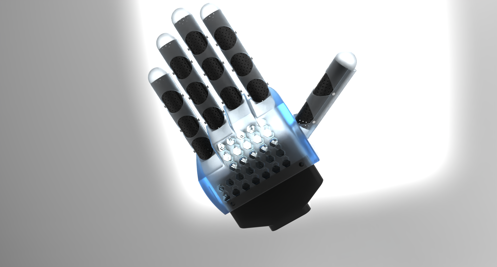

# 伟立杯手套

> 基于绳传动 + 力控舵机的无传感器力反馈数据手套方案设计

## 目录结构
- `Body/` -存放主要内容
- `Note`  -存放零时想法

## 使用方法（包括INDEX）

### 项目效果图

*伟立杯手套 - 实物渲染效果*

### 项目简介

本项目为**机器人灵巧手力反馈数据手套**的设计方案，旨在实现对机器人灵巧手的**高精度遥操作**与**力反馈**，为强化学习、工业装配、医疗康复及VR/AR等领域提供数据采集与沉浸式交互终端。

核心创新点：
- 采用**绳传动 + 力控舵机**结构，实现**无传感器指腹力感知**（通过扭矩间接测量）
- 基于“三力汇交”力学模型，建立指腹力与电机扭矩的定量关系
- 单指接近4自由度（拇指3自由度），兼顾灵活性与穿戴舒适性

### 主要功能

- **手指运动捕捉**：实时采集操作者手指弯曲角度并同步控制灵巧手
- **力反馈功能**：将灵巧手指腹接触力通过扭矩舵机实时反馈给操作者
- **力感知功能**：无需指腹传感器，通过绳传动与舵机扭矩实现 ≥0.5N 精度感知
- **舒适穿戴**：魔术贴 + 凝胶蜂窝垫 + 透气带孔皮革设计

### 性能指标

- 五指手套，适配正常成年人手型
- 力感知精度：≥0.5N（目标可达0.2N）
- 单指力反馈自由度：接近4DOF（拇指3DOF）
- 核心元件：飞特HLS3625力控舵机 + RP-W2.5-L15.5薄膜压力传感器（灵巧手端）
### 团队成员

- 张航诚（机制231）
- 王齐权（机制231）
- 陈煜暄（机制231）

**指导教师**：沈天曜

## 保留内容

### 学习许可与权利保留

- 本项目允许个人、学校和研究者进行非商业性的学习、研究和引用。
- 未经著作权人书面许可，不得将项目内容用于商业开发、产品制造、商业服务、商业宣传、投标交付、毕业设计成品交付或再授权。
- 不得删除作者、来源、版本历史和第三方许可证声明，不得将本项目或其衍生成果宣称为与作者无关的原创项目。
- 软件源码适用 [PolyForm Noncommercial 1.0.0](https://polyformproject.org/licenses/noncommercial/1.0.0/)；机械模型、PCB、原理图、图片、文档、Unity 工程和其他非软件资料适用 [CC BY-NC-ND 4.0](https://creativecommons.org/licenses/by-nc-nd/4.0/)。
- SE、SW、STEP/STP 及其他三维模型仅允许个人或学校进行非商业学习、评审和研究；未经著作权人书面许可，不得用于加工、打样、制造、销售、量产、投标、产品交付、商业宣传、改作或再授权。
- 第三方组件、模板、元件库、外购件模型和工具仍受其原始许可证约束；本声明不扩大作者对第三方内容的权利。

商业使用、产品化、公司内部长期使用、转让或排他性授权需另行取得著作权人的书面许可。